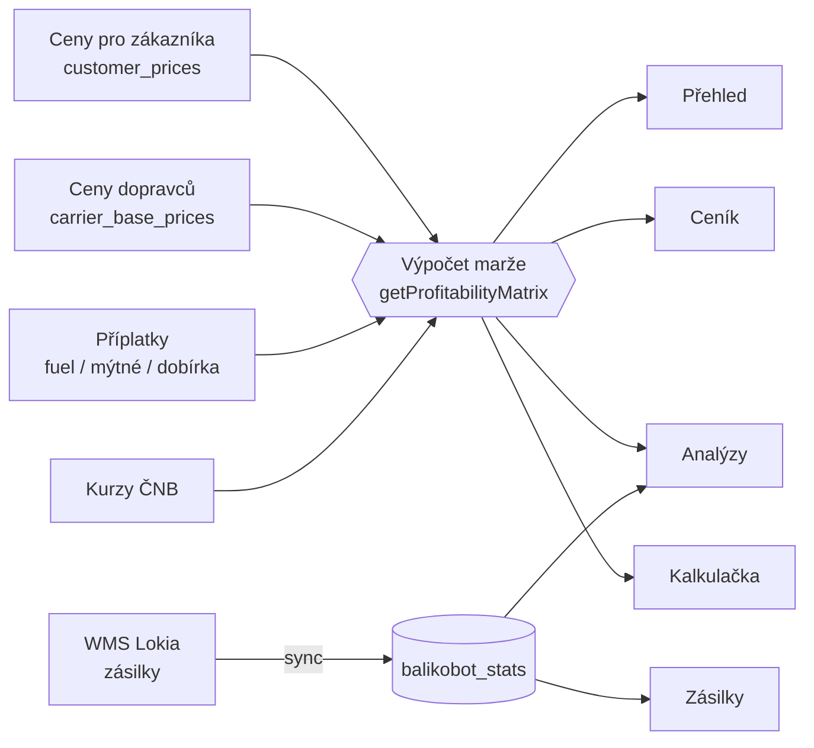

# Shipping Dashboard

Webová aplikace pro **controlling nákladů na dopravu v e-commerce**. Hlídá marži na každé
trase (země × dopravce × služba), příplatky dopravců, faktury a objemy zásilek – a to vše
napříč více zeměmi a měnami.

> *English summary:* a Next.js + Supabase dashboard that compares what customers pay for
> shipping with what carriers charge (base price + fuel/toll/COD surcharges, VAT and FX
> included), shows the margin per route, simulates the impact of surcharge changes, tracks
> carrier invoices and pulls shipment volumes from a WMS. The UI is in Czech.

## Co aplikace umí

| Stránka | Účel |
|---|---|
| **Přehled** `/dashboard` | Zdraví marží dle země, matice marží, nejztrátovější trasy, aktuální palivové příplatky |
| **Ceník** `/cenik` | Ceny pro zákazníka vs. ceny dopravců, výpočet marže, editace, **aktivace/deaktivace dopravy** |
| **Kalkulačka** `/kalkulacka` | „Co kdyby" – simulace změn cen, přepočet marží, export do CSV |
| **Dopravci** `/dopravci` | Smlouvy s dopravci, platnost, kontakty, import ceníku z PDF pomocí AI |
| **Faktury** `/faktury` | Faktury dopravců a odchylka od smluvních cen |
| **Zásilky** `/zasilky` | Počty zásilek a dobírek z WMS (Lokia), rozdělení dle dopravce/služby, export do Excelu |
| **Analýzy** `/analyzy` | Trendy marží, vývoj příplatků, využití dopravců, simulátor vlivu změny palivového příplatku |
| **Příplatky** `/priplatky` | Správa příplatků, hromadná aktualizace palivového příplatku |
| **Průzkum trhu** `/trh` | Ceny dopravy u konkurence vs. naše ceny |
| **Nastavení** `/nastaveni` | Synchronizace kurzů ČNB |

Podrobný popis výpočtů, datového modelu a synchronizace: **[docs/HOW-IT-WORKS.md](docs/HOW-IT-WORKS.md)**.

## Jak to funguje (zkráceně)



- **Marže** = cena pro zákazníka bez DPH − (cena dopravce + příplatky), vše převedené do měny
  země. Počítá se při hmotnosti **2 kg**, aby byly všechny stránky konzistentní.
- **Zásilky** se stahují z WMS Lokia, agregují po měsících a ukládají do Supabase.
- **Kurzy** se denně stahují z ČNB.
- **Deaktivovaná doprava** zůstává v ceníku (červeně, včetně historie), ale nezapočítává se do
  marží, dashboardu ani statistik v Analýzách.

## Technologie

- [Next.js](https://nextjs.org) 16 (App Router) + React 19 + TypeScript
- [Supabase](https://supabase.com) (PostgreSQL) – `@supabase/supabase-js`, `@supabase/ssr`
- Tailwind CSS 4, komponenty [shadcn](https://ui.shadcn.com) / [Base UI](https://base-ui.com)
- Recharts (grafy), date-fns, sonner (notifikace), xlsx (export)
- Anthropic SDK – vyčítání PDF ceníků dopravců (volitelné)
- Nasazení: Vercel (cron úlohy v `vercel.json`) + GitHub Actions pro dávkovou synchronizaci

## Rychlý start

### 1. Požadavky
- Node.js 20+
- Projekt na [Supabase](https://supabase.com) (stačí bezplatný)

### 2. Instalace
```bash
git clone <URL-repozitáře>
cd shipping-dashboard
npm ci
```

### 3. Databáze
V Supabase → **SQL Editor** spusťte migrace ze složky `supabase/migrations/` **postupně podle názvu**
(`001_…` až `017_…`). Migrace se stejným číslem (`011_*`, `012_*`) jsou na sobě nezávislé.

Migrace založí schéma a základní číselníky (země, dopravci, mapování Lokia). **Ceny, smlouvy a
příplatky jsou prázdné** – zadáte je v aplikaci.

### 4. Konfigurace
```bash
cp .env.local.example .env.local
```
Vyplňte hodnoty (níže). Soubor `.env.local` je v `.gitignore` – **nikdy ho necommitujte**.

### 5. Spuštění
```bash
npm run dev      # http://localhost:3000
npm run build    # produkční build
npm run lint
```

## Proměnné prostředí

| Proměnná | Povinná | Účel |
|---|---|---|
| `NEXT_PUBLIC_SUPABASE_URL` | ano | URL Supabase projektu |
| `NEXT_PUBLIC_SUPABASE_ANON_KEY` | ano | Anon klíč (Settings → API) |
| `SUPABASE_SERVICE_ROLE_KEY` | pro synchronizaci | Service-role klíč – jen na serveru, **nikdy do klienta** |
| `LOKIA_API_USER`, `LOKIA_API_PASSWORD` | pro Zásilky | Přístup do WMS Lokia |
| `CRON_SECRET` | doporučeno | Chrání `GET /api/cron/*`; Vercel ho posílá jako Bearer token |
| `ANTHROPIC_API_KEY` | volitelné | Vyčítání PDF ceníků na stránce Dopravci |

Bez přístupu k Lokia zůstanou stránky **Zásilky** a část **Analýz** (využití dopravců) prázdné,
zbytek aplikace (ceník, marže, kalkulačka, příplatky, faktury) funguje samostatně.

## Automatické úlohy

| Úloha | Kde | Kdy |
|---|---|---|
| Kurzy ČNB | Vercel cron → `/api/cron/exchange-rates` | Po–Pá 15:00 UTC |
| Synchronizace zásilek z Lokia | Vercel cron → `/api/cron/lokia-sync` | Po–Pá 18:00 UTC |
| Dávková synchronizace / backfill | GitHub Action `.github/workflows/lokia-sync.yml` | ručně nebo Po–Pá 18:00 UTC |

Pro GitHub Action nastavte v repozitáři **Settings → Secrets and variables → Actions** tajné
hodnoty `SUPABASE_URL`, `SUPABASE_SERVICE_ROLE_KEY`, `LOKIA_API_USER`, `LOKIA_API_PASSWORD`.

## Struktura projektu

```
src/
  app/                 stránky (App Router) a API routes
    api/cron/          synchronizace kurzů a zásilek
    api/parse-pricelist/   AI vyčítání PDF ceníků
    api/branch-map/    mapování sub-dopravců Zásilkovny
    api/export/        export zásilek do Excelu
  components/          UI dle stránek (pricing, analytics, shipments, …) + ui/ základní prvky
  lib/
    data.ts            načítání dat ze Supabase + výpočet marží (getProfitabilityMatrix)
    lokia.ts           klient WMS Lokia
    lokia-aggregate.ts agregace zásilek do měsíčních statistik
    constants.ts       číselníky, měny, přepočty (toCZK)
  types/index.ts       TypeScript typy
scripts/               samostatné skripty pro synchronizaci (GitHub Actions)
supabase/migrations/   SQL migrace
docs/HOW-IT-WORKS.md   podrobný popis fungování
```

## Bezpečnost – přečtěte si před nasazením

Aplikace je navržená jako **interní nástroj a nemá přihlašování**. Data v Supabase jsou dostupná
přes veřejný anon klíč (RLS je u tabulek vypnuté, viz migrace `004` a `017`), a API routes
(`/api/parse-pricelist`, `/api/branch-map`, …) nevyžadují autentizaci. Pokud aplikaci nasadíte
na veřejnou adresu:

- zapněte ochranu na úrovni hostingu (např. Vercel Password Protection / SSO), **nebo**
- doplňte Supabase Auth a RLS politiky a přidejte kontrolu přihlášení do API routes,
- vždy nastavte `CRON_SECRET`, jinak může kdokoli spouštět synchronizaci,
- pamatujte, že `/api/parse-pricelist` spotřebovává kredit Anthropic API.

Do repozitáře nikdy nedávejte reálné klíče ani hesla; používejte `.env.local` a tajné hodnoty
hostingu / GitHub Actions.
